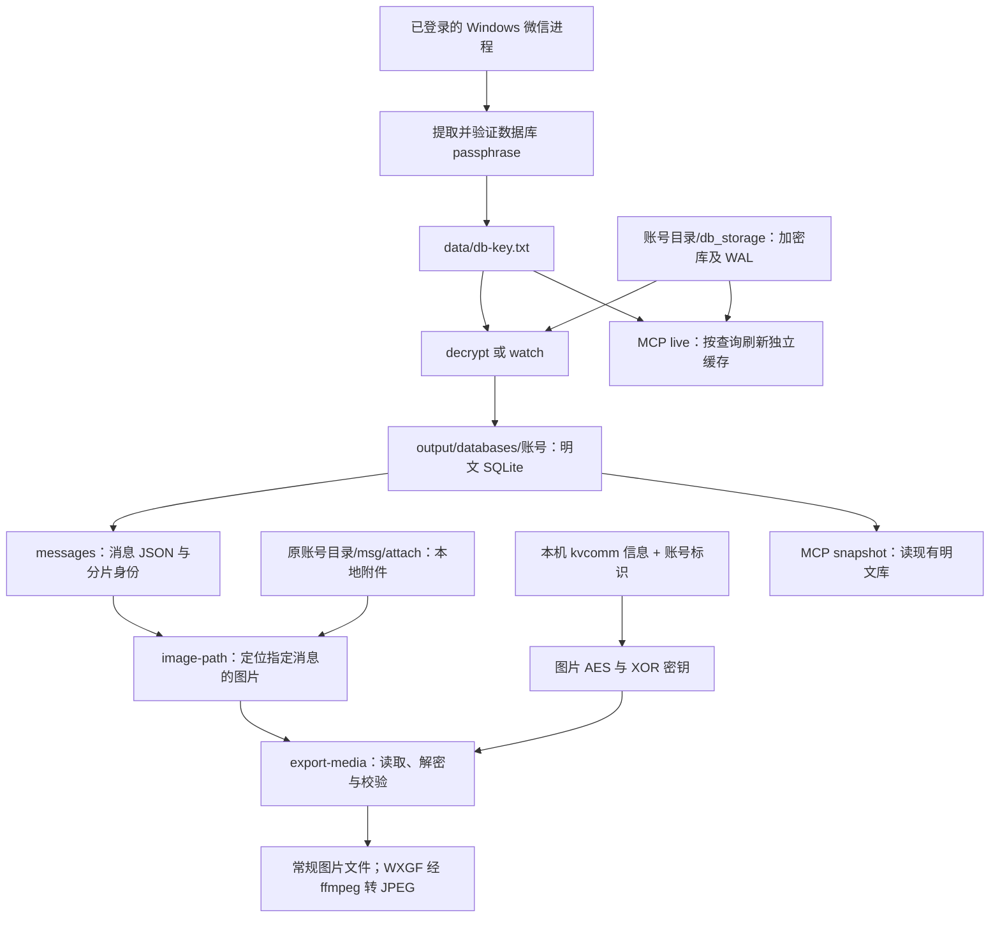

# 工作流：从微信本地数据到消息与图片

本项目把微信已同步到本机的数据转换为可读取的数据库、消息 JSON 和媒体文件，供脚本或 AI 使用。它不负责发送消息、操控微信界面、生成日报或识图；这些能力由调用方在取得数据后实现。

本文描述当前已实现的流程。命令在项目根目录的 PowerShell 中运行，示例账号、会话和消息编号都需要替换；不要把示例值当作实际账号信息。

## 整体流程



数据库里主要存消息内容、发送者、类型和附件索引；图片文件通常另存在 `msg/attach`。因此，解密数据库后能看到“这是一条图片消息”，并不等于已得到可以打开的图片。

| 步骤 | 输入 | 作用与输出 |
| --- | --- | --- |
| 提取数据库密钥 | 已登录的微信进程、该账号的加密数据库 | 找到并用数据库首页验证 passphrase，保存为密钥文本 |
| 解密数据库 | 数据库密钥、`db_storage` 及其 WAL | 生成独立的明文 SQLite 副本，不覆盖微信源库 |
| 读取消息 | 单账号明文目录、会话 username | 跨分片读取，解压消息正文、解析发送者与消息类型，输出 JSON |
| 定位图片 | 消息身份、明文索引、原附件目录 | 找到该消息对应的本地文件，或明确报告缺失/歧义 |
| 解密图片 | 本地图片、图片 AES/XOR 密钥 | 还原图片内容，必要时转码，校验后写入导出目录 |
| 提供 MCP | snapshot 或 live 配置 | 将消息读取、解析和媒体导出能力提供给 MCP 客户端 |

## 先分清目录与两类密钥

| 名称 | 示例 | 用在哪里 |
| --- | --- | --- |
| 原账号目录 | `D:/xwechat_files/wxid_example_abcd` | 内含 `db_storage` 和 `msg/attach`；传给 `--source-account-dir` 或图片命令的 `--account-dir` |
| 加密数据库目录 | 原账号目录下的 `db_storage` | 密钥脚本的 `--db-dir`，解密命令的 `--input` |
| 明文账号目录 | `output/databases/wxid_example` | `messages`、`image-path`、`export-media` 的 `--account-dir` |
| 密钥与配置目录 | `data/` | 保存数据库密钥、可选图片密钥和 MCP 配置；不提交 Git |
| 导出目录 | `output/media/`、`output/images/` | 保存解密后的媒体；不提交 Git |

**数据库密钥**：脚本提取的是 32 字节 passphrase，文件中表示为 64 个十六进制字符。解密器结合每个数据库的 salt 派生密钥，用于数据库页解密。某一库的原始加密密钥不一定能用于其他库；已有密钥可以直接使用，不必每次运行都重新提取。

**图片密钥**：是 AES-128 密钥和一个 XOR 字节，来自另一条链路。当前实现从 Windows 用户目录下的 `AppData/Roaming/Tencent/xwechat/net/kvcomm` 文件名取得候选 code，再结合账号标识推导。它不是 `db-key.txt`，不能用数据库密钥替代。

图片命令默认在内部推导密钥，不必先把图片密钥打印出来。若在另一台机器处理复制来的数据，通常还需要提供对应图片密钥，或指向保存了所需 `kvcomm` 信息的用户目录。

## 1. 准备环境与路径

安装 Python 3.11+ 和 uv；在项目根目录执行：

```powershell
uv sync --group dev
New-Item -ItemType Directory -Path data, output -Force | Out-Null

# 替换为实际的单个账号目录与会话 username。
$sourceAccount = 'D:/xwechat_files/wxid_example_abcd'
$dbStorage = Join-Path $sourceAccount 'db_storage'
$chat = 'example@chatroom'
```

`$chat` 必须是精确的会话 username，不是显示昵称。已知 ID 可直接填写；未知时，可在数据库解密后通过 MCP 的 `get_recent_sessions` 或 `get_contacts` 查询。当前基础 CLI 尚无会话枚举命令。

提取数据库密钥时，Windows 微信应已启动并登录相应账号，当前进程须有读取微信进程内存的权限。仅停留在登录界面可能取不到所需密钥。若处理已有密钥与数据库副本，可跳过取密钥步骤。

## 2. 提取并保存数据库密钥

```powershell
uv run python tools/extract_windows_key.py --db-dir "$dbStorage" --out data/db-key.txt
```

脚本定位微信进程和 `Weixin.dll`，按已知特征提取候选值，并用指定数据库的首页校验。成功后把密钥写入文件，控制台只报告写入结果及通过首页验证的库数量，不打印密钥正文。

确认输出文件已生成，并检查首页验真数量。当前脚本即使只验证通过部分数据库也可能保存密钥并成功退出；部分通过时应核对账号与数据库来源，不能据退出码断言所有库都可解密。后面的解密结果才反映实际逐库处理情况。

脚本不会覆盖已有密钥文件。如确需重新提取，给 `--out` 一个新的文件名，再比较验证结果。出现“未定位到 Weixin.dll”“未匹配到已知掩码特征”或“未找到通过验真的密钥”，分别检查进程权限、客户端版本兼容性与账号/登录状态。

## 3. 解密数据库，得到可查询的副本

```powershell
uv run wechat-extract decrypt --key-file data/db-key.txt --input "$dbStorage" --output output
Get-ChildItem output/databases -Directory
```

解密器处理数据库页，并合并已提交的 WAL。WAL 可能保存尚未写回主库的新消息；离线搬运数据库时只复制 `.db`，可能遗漏这些变化。本工具的稳定读取与验证不能补回未复制的数据。

结果位于 `output/databases/<账号>/`，其中保留数据库的相对目录布局，日志位于 `output/logs/`。检查命令的成功/失败数量和退出码：空输入或部分失败会返回非零。

**明文账号目录以实际输出为准。** 实现会规范化账号名，例如原目录 `wxid_example_abcd` 对应的输出可能是 `wxid_example`，不要直接用原目录名拼接。

```powershell
# 确认上一步实际输出后填写；不要指向整个 output/databases。
$plainAccount = 'output/databases/wxid_example'
```

需要持续更新时，用下面命令代替反复手工 `decrypt`：

```powershell
uv run wechat-extract watch --key-file data/db-key.txt --input "$dbStorage" --output output --interval 2
```

`watch` 轮询并处理变化，Ctrl+C 停止；加 `--once` 只执行一轮。它更新明文库，不是消息订阅，也不会自动导出每张新图片。输出库有冲突的 WAL/SHM/journal 或被其他程序写入时可能无法发布新副本，应先解决输出目录占用。

## 4. 读取消息，取得完整的定位信息

```powershell
uv run wechat-extract messages --account-dir "$plainAccount" --chat "$chat" --limit 20
```

该命令输出 JSON；保留 `conversation`、`shard`、`table`、`local_id`、`create_time`、`server_id` 等身份字段，并给出 `sender_username`、`content_text`、`message_type` 等读取结果。类型解析使调用方能够区分文本、图片、语音和应用消息；卡片的进一步解析可通过 MCP 消息详情工具使用。

从结果中选一条图片消息，原样记下它的 `local_id` 与 `shard`：

```powershell
# 仅为示例，必须替换为上一步真实返回的值。
$messageId = 7
$messageShard = 'message/message_1.db'
uv run wechat-extract messages --account-dir "$plainAccount" --chat "$chat" --local-id $messageId --shard "$messageShard"
```

同一会话在不同分片里可能出现相同 `local_id`。只记消息编号会取错消息；`shard` 可能带 `message/` 等目录前缀，也不能擅自裁掉。

## 5. 定位、解密并导出指定图片

先确认该消息是否有对应的本地图片：

```powershell
uv run wechat-extract image-path --account-dir "$plainAccount" --source-account-dir "$sourceAccount" --chat "$chat" --local-id $messageId --shard "$messageShard" --tier best
```

`image-path` 只定位，不解密、不复制。成功结果给出文件路径、实际档位与消息身份；若未缓存或有多个无法区分的候选，会返回相应状态，不任选一张图。

随后导出：

```powershell
uv run wechat-extract export-media --account-dir "$plainAccount" --source-account-dir "$sourceAccount" --chat "$chat" --local-id $messageId --shard "$messageShard" --kind image --tier best --output output/media
```

内部流程是：稳定读取本地文件 → 取得图片密钥 → 解开 DAT 的 AES 段和 XOR 段并保留中间明文 → 判断图片格式 → 必要时转码 → 完整解码校验 → 原子写出。已是常规图片的文件不需要再解密。

成功以 JSON 中的 `status: ok` 和 `output_path` 为准，不自行猜文件名。目录按账号来源、分片、消息表和编号隔离。`--tier original` 明确要求原图，缺失时不会降级；`best` 可以选择已有的其他档位，不等于一定获得原图。

WXGF 是微信图片容器，需使用支持 HEVC 解码的 ffmpeg 转为 JPEG。普通 JPEG/PNG 不需要此转换；按消息导出可用 `--ffmpeg "<ffmpeg 可执行文件路径>"` 指定程序，批量图片命令则从 PATH 查找。

图片密钥自动推导失败时，先确认原账号目录名与 `kvcomm` 所属账号；必要时在微信中手动打开过图片后重试。`--userprofile` 可指定 `kvcomm` 所在的用户主目录，它与图片存储所在的磁盘路径是两个参数。已有图片密钥可在导出命令后附加：

```powershell
# data/image-keys.json 中自行填写 aes_key 和 xor_key，文件不提交 Git。
# aes_key 接受 16 个 ASCII 字符或 32 位 hex；xor_key 是 0–255 的整数。
uv run wechat-extract export-media --account-dir "$plainAccount" --source-account-dir "$sourceAccount" --chat "$chat" --local-id $messageId --shard "$messageShard" --kind image --image-key-file data/image-keys.json --output output/media
```

DAT 头部长度存在两种解释。默认 `--aes-size-mode ciphertext`，已知数据采用明文长度语义时显式改为 `plaintext`；程序不会自动猜两种模式。密钥错误、格式不匹配和文件未下载完整都可能导致失败，不能一概判断为图片密钥过期。

### 可选：不按消息定位，批量处理会话目录

```powershell
uv run wechat-image-decrypt --account-dir "$sourceAccount" --chat "$chat" --out output/images
```

此入口直接扫描会话附件目录，依赖原账号目录、会话 username 和可推导的图片密钥；**不需要先解密数据库**。它适合批量提取已经落地的图片，但不返回消息身份，也不证明某张图对应哪条消息。

当前批量入口扫描各月份 `Img/*.dat`，排除 `_t.dat` 与 `_h.dat`，不等于导出所有档位或所有本地图片格式。它的格式识别与写出流程也不等同于按消息导出的完整校验链。需准确关联消息、指定档位或严格检查输出时，使用上面的 `export-media`。

`wechat-image-decrypt --keys` 会打印图片密钥及本机信息；正常解密流程不需要此选项。

## 6. 将读取能力交给 AI：MCP

MCP 是同一套本地读取能力的工具接口，不会自动提取数据库密钥。先完成取密钥，或准备已有明文数据库，再选一种模式：

| 模式 | 适合场景 | 准备工作 |
| --- | --- | --- |
| `snapshot` | 读取已有明文快照，结果固定在那份数据的状态 | 将 `examples/mcp-snapshot.json` 复制到 `data/mcp-config.json`，填写明文账号目录、原附件目录和导出目录 |
| `live` | 调用时按所需数据库范围刷新 | 复制 `examples/mcp-live.json`，填写 `db_dir`、原账号目录、密钥文件、专用空缓存目录和导出目录 |

```powershell
# 二选一；复制后先编辑路径，再启动。
Copy-Item examples/mcp-snapshot.json data/mcp-config.json
uv run wechat-mcp --config data/mcp-config.json
```

配置里的相对路径基于**配置文件所在目录**，不是 shell 当前目录。例如配置放在 `data/` 时，`key_file: "db-key.txt"` 指向 `data/db-key.txt`。live 模式用自己的缓存，不要再让 `watch` 向同一目录写入；snapshot 模式读取 CLI 产出的已有副本即可。

默认 stdio，通常由 MCP 客户端按上述命令拉起；单独运行后等待协议输入属于正常现象。客户端可依次调用 `get_status`、`get_recent_sessions`、`get_chat_history`、`get_message_detail` 和 `export_media`。具体工具参数、HTTP 配置及限制见 [MCP 服务](mcp.md)。

图片消息导出使用本地附件；**动画表情是另外的链路**，当前 MCP 在表情缓存未命中时会访问白名单 CDN。基础 CLI 的 `export-media` 没有 `emoji` 类型。不要把“本地图片解密”和“联网下载表情”混为一谈。

## 常见结果如何理解

| 现象 | 优先检查 |
| --- | --- |
| 数据库能解密，图片不能打开 | 图片需要独立的 AES/XOR 密钥，且附件必须已同步到本机 |
| 图片消息存在，但定位为 missing | 是否使用同账号的原附件目录；图片可能未缓存，消息存在不保证附件存在 |
| 返回 ambiguous | 原样提供分片；多候选时不按文件时间或同名文件猜测 |
| 明文目录下读不到预期消息 | 是否选中单账号目录、是否刷新、是否遗漏 WAL；本机未同步的消息不在读取范围 |
| 原图导出失败，缩略图存在 | 明确的原图档位不会自动降级，需要调用方决定是否接受其他档位 |
| WXGF 转换失败 | ffmpeg 是否可调用且支持 HEVC；文件是否完整，格式是否受支持 |
| MCP 启动后没有新消息输出 | stdio 需要客户端发起调用；服务不是自动打印消息的订阅终端 |

密钥、明文数据库、消息 JSON、日志和媒体都是运行产物，保存到 `data/` 或 `output/`，不要作为项目样本提交。完整字段与路径依据见 [存储路径与分片身份](storage-and-shards.md)；实际验证过的媒体范围见 [媒体验证记录](media-validation.md)。
